<div align="center">


<a href="https://github.com/akshay-rajkumar">
  
</a>

<br/>


</div>

<br/>

## `~/about`

```bash
$ whoami
A Akshay

$ cat about.json
{
  "role":     "Computer Science & Business Systems student",
  "building": ["Full-stack apps", "Privacy & security tooling", "Backend systems"],
  "exploring": ["Cybersecurity", "Machine Learning", "Anomaly Detection"],
  "sharpening": "Problem solving & DSA",
  "motto":    "Understand how it works under the hood"
}
```

<br/>

## `~/skills`

<div align="center">

| | |
|:---|:---|
| **Languages** |  |
| **Frontend** |  |
| **Backend** |  |
| **Data & Infra** |  |
| **Tools** |  |

<sub>Also exploring: <code>OPA</code> · <code>Rego</code> · <code>Isolation Forest</code> · <code>WebSockets</code> · <code>Tauri</code> · <code>Rust</code> · <code>nftables</code></sub>

</div>

<br/>

## `~/projects`

<table width="100%">
<tr>
<td width="50%" valign="top">

### 🔐 Privacy-Preserving Data Sharing Gateway
*A multi-layer gateway for controlled, secure data exchange.*

🔸 Policy-based access control<br/>
🔸 AES-256 encryption & audit logging<br/>
🔸 Multi-node data transfer

`Java` `Spring Boot` `React` `TypeScript` `PostgreSQL` `OPA` `Rego`

[**View Project →**](https://github.com/akshay-rajkumar/Privacy-Gateway)

</td>
<td width="50%" valign="top">

### 🎬 HORIZONX
*A movie discovery & streaming platform prototype powered by TMDB.*

🔸 Movie and TV browsing<br/>
🔸 Express proxy that protects the API key<br/>
🔸 Rate limiting & security headers

`JavaScript` `HTML` `CSS` `Node.js` `Express`

[**View Project →**](https://github.com/akshay-rajkumar/HORIZONX)

</td>
</tr>
<tr>
<td width="50%" valign="top">

### 🛡️ Ghostware
*Security monitoring and automated threat response.*

🔸 Anomaly detection with Isolation Forest<br/>
🔸 Live alerts over WebSockets<br/>
🔸 Automated blocking with nftables

`Python` `Isolation Forest` `WebSockets` `Linux` `nftables` `Bash`

[**View Project →**](https://github.com/sangeethmarisamy/Ghostware)

</td>
<td width="50%" valign="top">

### 📄 PDF & DOCX Desktop Tool
*A desktop app for viewing PDFs and editing DOCX files.*

🔸 PDF viewing<br/>
🔸 DOCX reading and editing<br/>
🔸 Native open / save

`React` `Tauri 2` `Rust` `PDF.js` `TipTap`

[**View Project →**](https://github.com/akshay-rajkumar/pdf_tool)

</td>
</tr>
<tr>
<td width="50%" valign="top">

### 🩸 Blood Bank Management System
*Blood inventory and donor management on the web.*

🔸 Donor registration & records<br/>
🔸 Blood stock and storage units<br/>
🔸 Secure user authentication

`Java` `Spring Boot` `Spring Security` `Thymeleaf` `MySQL`

[**View Project →**](https://github.com/akshay-rajkumar/Smart-Blood-Maintanence-and-Donor-Recruitment-)

</td>
<td width="50%" valign="top">

### ✨ More on the way
*Always building something new.*

🔸 Browse all my repositories for the rest

[**All Repositories →**](https://github.com/akshay-rajkumar?tab=repositories)

</td>
</tr>
</table>

<br/>

## `~/problem-solving`

<div align="center">

### 640+ problems solved across platforms


<br/>


</div>

<br/>

## `~/analytics`

<div align="center">








</div>

<br/>

## `~/contribution-snake`

<div align="center">

<picture>
  <source media="(prefers-color-scheme: dark)" srcset="https://raw.githubusercontent.com/akshay-rajkumar/akshay-rajkumar/output/github-contribution-grid-snake-dark.svg" />
  <source media="(prefers-color-scheme: light)" srcset="https://raw.githubusercontent.com/akshay-rajkumar/akshay-rajkumar/output/github-contribution-grid-snake.svg" />
  
</picture>

</div>

<br/>

## `~/currently-learning`

```text
▶ Advanced Java & Spring Boot
▶ Full-stack development
▶ Data structures & algorithms
▶ Cybersecurity & ethical hacking
▶ Machine learning & anomaly detection
▶ System design & backend architecture
```

<br/>

## `~/connect`

<div align="center">

<a href="https://github.com/akshay-rajkumar"></a>
<a href="https://www.linkedin.com/in/a-akshay-kit/"></a>
<a href="mailto:kit28.24bcb002@gmail.com"></a>

<br/><br/>

*"Build things. Break things. Understand why. Build them better."*


</div>
